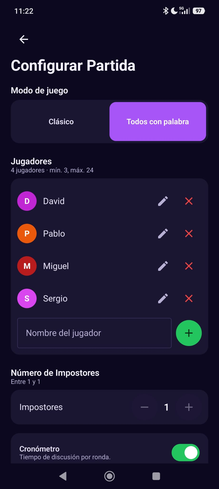
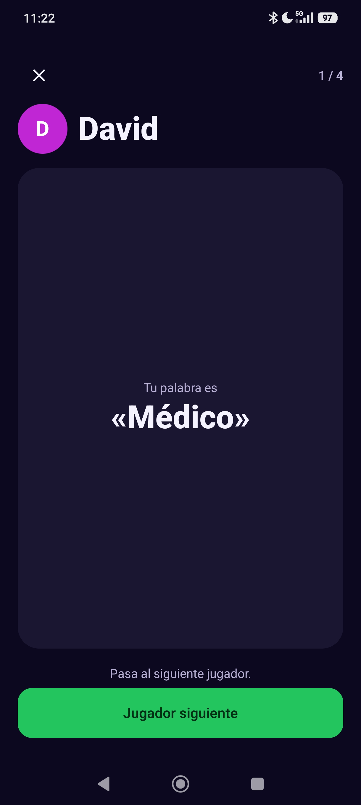
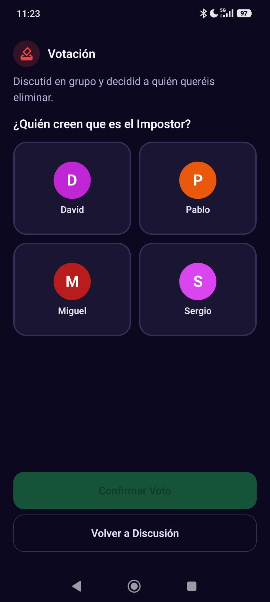
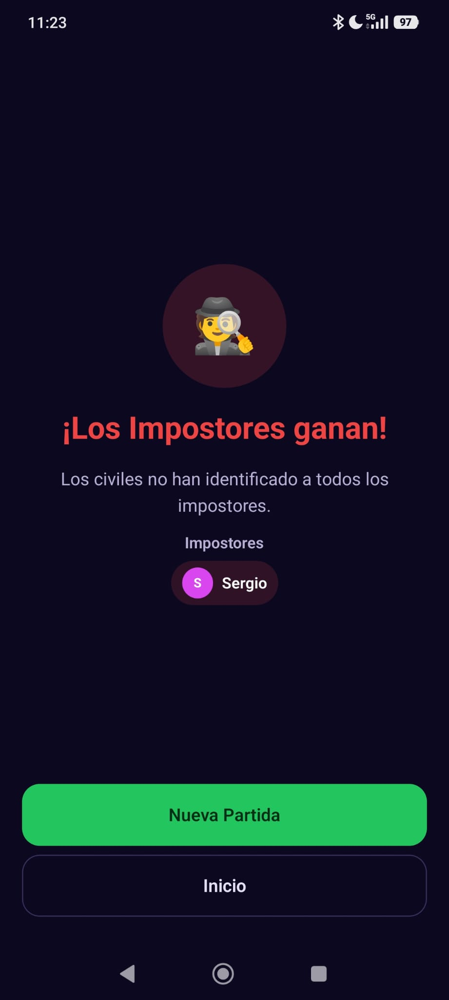

<h1 align="center">🕵️ Impostor</h1>

<p align="center">
  <strong>Juego de fiesta para Android en el que un grupo de amigos tiene que descubrir quién es el impostor.</strong><br>
  100 % offline · un solo móvil que se pasa de mano en mano · 1.421 pares de palabras en español
</p>

<p align="center">
  
  
  
</p>


<p align="center">
  
  
  
  
</p>

---

## ¿Cómo se juega?

Todos los jugadores reciben la misma palabra secreta… menos los impostores. Por turnos, cada jugador dice una palabra relacionada con la suya, intentando demostrar que la conoce sin dársela en bandeja al impostor. El impostor, mientras tanto, tiene que disimular y deducir la palabra a partir de lo que oye. Al final se debate y se vota.

1. **Configuración**: se añaden los jugadores (mínimo 3), el número de impostores, el modo de juego, la pista y el cronómetro.
2. **Categorías**: se eligen una o varias categorías de las que saldrá la palabra.
3. **Reparto de roles**: el móvil pasa de mano en mano y cada jugador desliza hacia arriba su carta para ver en secreto su palabra o su rol.
4. **Ronda de palabras**: la app sortea quién empieza.
5. **Debate**: con cronómetro opcional (de 1 a 10 minutos).
6. **Votación y resultado**: se vota a los sospechosos y la app revela si los civiles han acertado.

## Modos de juego

| Modo | Civiles | Impostores |
|---|---|---|
| **Clásico** | Ven la palabra secreta | Saben que son impostores. Opcionalmente reciben una **pista** relacionada |
| **Todos con palabra** | Ven la palabra secreta | Reciben una palabra **parecida pero distinta**, y no saben que son impostores |

El número máximo de impostores se ajusta automáticamente al número de jugadores, para que la partida siempre sea equilibrada.

## Dataset propio

La app incluye un dataset creado a mano con **1.421 pares palabra-pista** en 8 categorías, con algunas referencias culturales asturianas:

| Categoría | Pares |
|---|---|
| Profesiones | 207 |
| Vida cotidiana | 204 |
| Animales y naturaleza | 181 |
| Comida y bebida | 177 |
| Tecnología | 172 |
| Deportes | 165 |
| Lugares y geografía | 162 |
| Películas y series | 153 |

Cada par tiene una palabra para los civiles y otra relacionada para el impostor (por ejemplo, *Pizza → Calzone* o *Médico → Estetoscopio*). Está en [`app/src/main/assets/categories.json`](app/src/main/assets/categories.json).

## Tecnologías y arquitectura

- **Kotlin** y **Jetpack Compose** (Material 3) para toda la interfaz.
- **MVVM** con un `ViewModel` por pantalla y estado expuesto mediante `StateFlow`.
- **Hilt** para la inyección de dependencias.
- **Room** para guardar la lista de jugadores habituales entre partidas.
- **DataStore** para recordar la última configuración (modo, impostores, pista y cronómetro).
- **Navigation Compose** para el flujo entre pantallas.
- **Kotlinx Serialization** para leer el dataset de palabras.

```
app/src/main/kotlin/com/davilex/impostor/
├── data/        # Room (jugadores), DataStore (ajustes) y lectura del dataset
├── domain/      # Modelos del juego y lógica de reparto de roles (StartGameUseCase)
├── navigation/  # Rutas y grafo de navegación
└── ui/          # Pantallas: setup, categorías, reparto, debate, votación y resultado
```

La lógica del juego (validar la configuración, elegir la palabra, repartir roles y sortear quién empieza) está en la capa de dominio, separada de la interfaz. Así se puede probar sin Android.

## Tests

Hay tests unitarios de la lógica de reparto de roles (`StartGameUseCaseTest`), que cubren entre otras cosas:

- La validación de la configuración (mínimo de jugadores, máximo de impostores, categorías vacías).
- El comportamiento de cada modo de juego, con y sin pista.
- Que cada jugador recibe exactamente un rol y que quien empieza es siempre un jugador de la partida.

```bash
./gradlew test
```

## Cómo ejecutarlo

Requisitos: Android Studio (versión reciente) y un dispositivo o emulador con **Android 8.0 (API 26)** o superior.

```bash
git clone https://github.com/davilex7/Impostor.git
```

Abre el proyecto en Android Studio y pulsa **Run**. No necesita claves ni conexión a internet.

---

<p align="center">Hecho por <a href="https://github.com/davilex7">David González</a></p>
